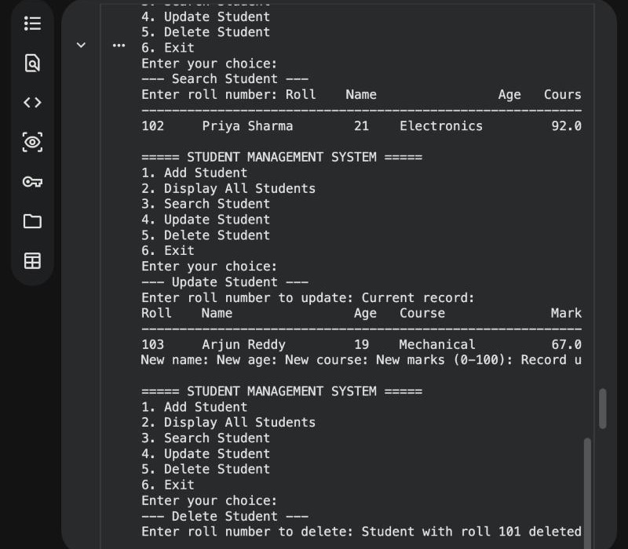
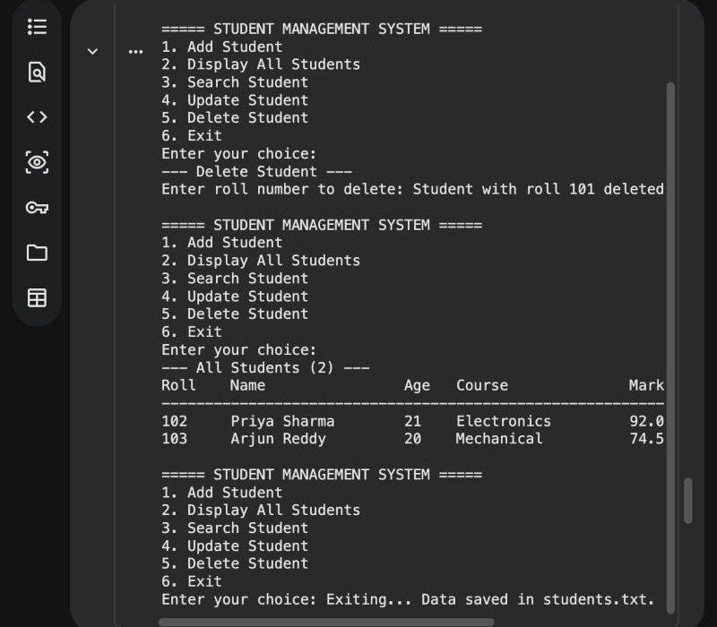
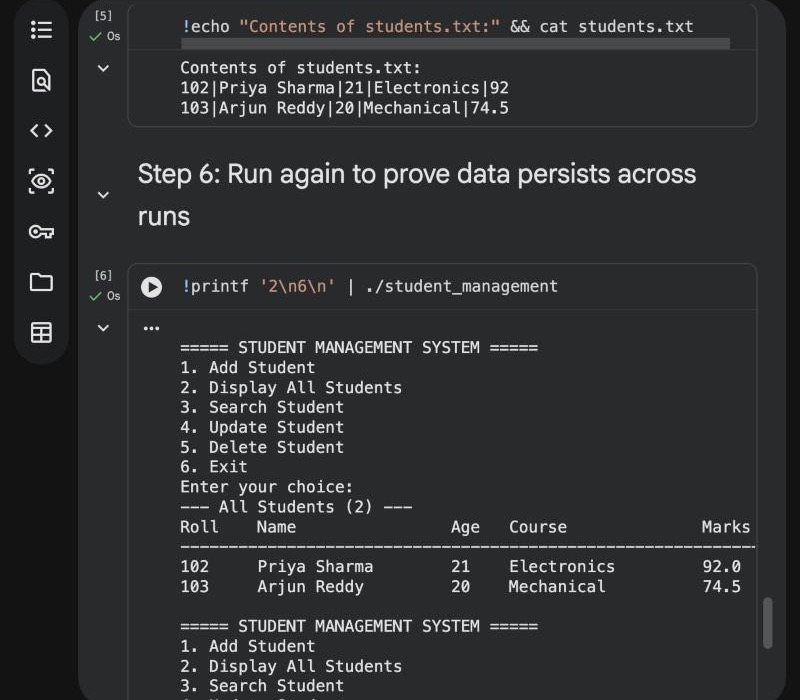

# Student Management System (C++)

A console-based Student Management System in C++ that manages student records using **file handling** and **menu-driven operations**.

[](https://colab.research.google.com/github/suma544/student-management-system/blob/main/Student_Management_System.ipynb)

## Key Features
- **Add** a student (roll number, name, age, course, marks)
- **Display** all students in a formatted table with grades
- **Search** a student by roll number
- **Update** a student's details
- **Delete** a student
- **File handling:** every change is saved to `students.txt` and loaded again on the next run
- **Menu-driven:** a simple numbered menu, with input checks for bad numbers and marks outside 0-100

## Files
| File | Description |
|------|-------------|
| `student_management.cpp` | Full C++ source code |
| `Student_Management_System.ipynb` | Google Colab notebook that writes, compiles and runs the program |
| `sample_input.txt` | Menu inputs used for the demo run |
| `output/colab_output.txt` | Full output from the Google Colab run |
| `output/students.txt` | Data file produced by the program |
| `output/*.jpg` | Screenshots of the Colab run |

## Run it yourself
**Google Colab:** click the badge above, then *Runtime → Run all*.

**Locally:**
```bash
g++ -std=c++17 -o student_management student_management.cpp
./student_management
```

## Output Screenshots (Google Colab)



